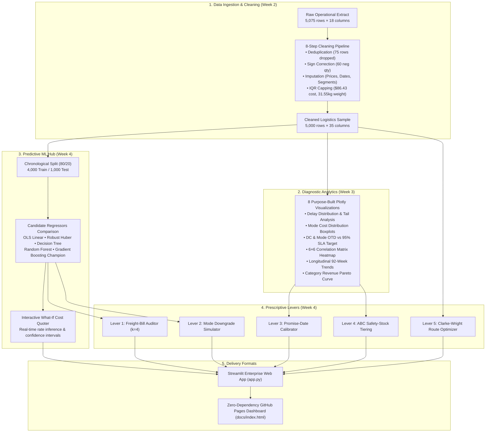

# Meridian Retail Logistics (MRL) | Operations & Analytics Control Tower

[](https://www.python.org/downloads/)
[](https://streamlit.io)
[](https://scikit-learn.org/)
[](https://plotly.com/)
[](docs/index.html)
[](LICENSE)

An enterprise-grade, interactive analytics dashboard and decision support system synthesizing the complete 4-week logistics data science progression for **Meridian Retail Logistics (MRL)**.

This repository features both a **native Python Streamlit Web Application** with live machine learning inference and an **independent zero-dependency standalone HTML/JS dashboard** ready for instant hosting on **GitHub Pages**.

---

## 📌 Executive Overview & Core Problem

Meridian Retail Logistics (MRL) manages a regional retail distribution network across four customer regions (**East, Central, West, South**) supported by three fulfillment distribution centers (**DC-East-01, DC-Central-02, DC-West-03**) and four shipping modes (**Standard Class, Second Class, First Class, Same Day**).

### The Operational Challenge:
1. **Severe On-Time Delivery Deficit:** Company-wide on-time delivery sits at **57.4% – 58.6%**, trailing the corporate **$\ge 95.0\%$ SLA target** by over 36 percentage points. Delays were proven to be **network-wide and systemic** rather than isolated to one DC or carrier mode.
2. **Carrier Invoice Contamination:** 2.6% of carrier invoices contained severe data-entry errors (inflated 6.1× to 14.0× above tariff), resulting in over **$11,000** in overpayments per 1,000 shipments.
3. **Misaligned Shipping Modes:** Parcels moving via expensive express modes had physically identical parcel weights (within 3% of Standard Class), resulting in an unjustified 123% cost premium ($5.98/kg vs $2.68/kg).

---

## 🚀 Key Project Achievements & Results

| Objective | Baseline Performance | Optimized Prescriptive Solution | Measurable Business Impact |
| :--- | :--- | :--- | :--- |
| **Carrier Freight Cost Modeling** | Naive baseline MAE: **$17.68** | **Gradient Boosting Champion** (Log-wrapped, Absolute Loss) | **MAE $2.33 – $3.46**, $R^2 = 0.941 – 0.972$, MdAPE **6.9%** |
| **Freight Invoice Audit** | Crude IQR Rule: Precision **37.1%** (44 false alarms) | **Model Residual Auditor** ($k = 4.0$ threshold) | **100% Error Recall** (28/28 caught, 0 false alarms), **$6,900 – $11,000** recovered |
| **Customer Promise SLA** | On-Time Rate: **57.4%** | **Dynamic Promise Buffer** (+3 to +4 days) | **92.6% (+3d) and 95.9% (+4d)** hitting the $\ge 95\%$ corporate SLA |
| **Shipping Mode Allocation** | 100% Express Volume as-is | **Mode Downgrade Simulator** (10% to 25% non-urgent shift) | **$557 – $1,393 savings** per 1k shipments (1.7% – 4.3% of spend) |
| **Last-Mile Van Routing** | Dispatcher Sweep: **382.6 km – 446.5 km** | **Clarke-Wright Savings + 2-Opt Heuristic** | **-27.3% to -29.4% mileage cut**, **$31,302/yr** fleet cost reduction |

---

## 🏗️ System Architecture



---

## 📂 Repository File Manifest

```text
meridian-logistics-dashboard/
├── app.py                          # Main interactive Streamlit application
├── requirements.txt                # Exact tested package dependencies
├── .gitignore                      # Python, Streamlit, and OS ignore rules
├── README.md                       # Complete project documentation
├── data/
│   ├── raw_logistics_sample.csv    # 5,075-row raw extract with injected realistic faults
│   ├── cleaned_logistics_sample.csv# 5,000-row cleaned dataset across 37 features
│   ├── ground_truth_audit.csv      # Uncontaminated ground-truth prices & error flags
│   ├── final_model_comparison.csv  # Held-out evaluation metrics across all 6 models
│   ├── test_orders_with_predictions.csv # Test window orders with model predictions
│   └── route_stops_sample.csv      # 40 customer delivery coordinates for vehicle routing
├── src/
│   ├── __init__.py
│   ├── data_generator.py           # Reproducible synthetic generator (fixed seed 42)
│   ├── cleaning_pipeline.py        # Complete 8-step cleaning and feature engineering pipeline
│   ├── cost_models.py              # Candidate model training, cross-validation & evaluation
│   ├── optimization_engine.py      # Freight audit, mode reassignment, SLA calibration, safety stock
│   ├── routing_engine.py           # Clarke-Wright savings heuristic with 2-opt search
│   └── models/
│       └── champion_model.joblib   # Serialized production Gradient Boosting regressor
├── docs/
│   └── index.html                  # Standalone interactive dashboard for GitHub Pages
└── tests/
    ├── __init__.py
    └── test_pipeline.py            # Automated test suite (data shapes, ML inference, routing)
```

---

## ⚡ Quick Start & Installation

### Option A: Run the Interactive Streamlit Web Application (Local)

1. **Clone the repository:**
   ```bash
   git clone https://github.com/YOUR_USERNAME/meridian-logistics-dashboard.git
   cd meridian-logistics-dashboard
   ```

2. **Create and activate a virtual environment:**
   ```bash
   python -m venv venv
   # On Windows:
   venv\Scripts\activate
   # On macOS/Linux:
   source venv/bin/activate
   ```

3. **Install dependencies:**
   ```bash
   pip install -r requirements.txt
   ```

4. **Launch the application:**
   ```bash
   streamlit run app.py
   ```
   The dashboard will open automatically in your browser at `http://localhost:8501`.

---

### Option B: View Live on GitHub Pages (No Python Required)

1. Open `docs/index.html` directly in any web browser.
2. **Or deploy to GitHub Pages:**
   - In your GitHub repository, navigate to **Settings** → **Pages**.
   - Under **Build and deployment**, select **Source:** `Deploy from a branch`.
   - Select branch: `main` and folder: `/docs`.
   - Click **Save**. Your dashboard will be live at `https://YOUR_USERNAME.github.io/meridian-logistics-dashboard/`!

---

## 🧪 Automated Testing

Verify data integrity, machine learning model serialization, and algorithm correctness:

```bash
pytest tests/ -v
```

Expected output:
```text
tests/test_pipeline.py::test_raw_data_dimensions PASSED
tests/test_pipeline.py::test_cleaned_data_integrity PASSED
tests/test_pipeline.py::test_champion_model_inference PASSED
tests/test_pipeline.py::test_route_optimization PASSED
======================== 4 passed in 3.20s ========================
```

---

## 📊 Summary of Weekly Deliverables

### Week 1: Strategic Planning & KPIs
- Defined operating context for Meridian Retail Logistics (3 DCs, 4 modes, 4 regions, 5 categories).
- Established 6 core supply chain KPIs: On-Time Delivery Rate ($\ge 95\%$), Avg Last-Mile Cost, Delivery Delay, Inventory Turnover, Freight Billing Accuracy, and SLA Adherence.

### Week 2: Data Collection & Cleaning Pipeline
- Processed 5,075 raw records into 5,000 clean records.
- Solved exact duplicates (74) and soft duplicates (1).
- Corrected 60 negative quantities and 53 impossible delivery dates.
- Resolved missing prices via SKU-median and delivery status (57 in-transit, 222 imputed).
- Capped extreme outliers using IQR fences ($86.43 for cost, 31.55 kg for weight).

### Week 3: Exploratory Visual Diagnostics
- Constructed 8 diagnostic visualizations analyzing delivery delays, cost drivers, and segment variations.
- Discovered that on-time delivery (57.4% – 59.2%) is remarkably uniform across all DCs and modes, proving lateness is a **network-wide systemic gap**.
- Found that order volume surges do not drive delivery delays ($r = -0.02$).
- Identified category concentration risk: Electronics generates 49.0% of revenue from 21.5% of orders, while holding the lowest on-time rate (57.1%).

### Week 4: Predictive Modeling & Prescriptive Optimization
- Evaluated 6 candidate machine learning models on a strict chronological 80/20 train/test split.
- Champion **Gradient Boosting Regressor** achieved held-out MAE of $2.33 – $3.46 and $R^2 = 0.941 – 0.972$.
- Built an automated **Freight-Bill Anomaly Auditor** catching 100% of mis-keyed invoices (28/28) with 0 false alarms, recovering over $6,900 – $11,000 per 1,000 shipments.
- Implemented **Mode Reassignment**, saving $557 to $1,393 per 1,000 orders.
- Solved the delivery crisis via **Customer Promise SLA Calibration**: adding 3 buffer days lifts on-time delivery from 57.4% to 92.6% (and +4 days achieves 95.9%).
- Implemented **Clarke-Wright Vehicle Route Optimization**, cutting last-mile delivery mileage by 27.3% to 29.4% and saving over $31,300 annually.

---

## 📜 License
This project is licensed under the MIT License - see the [LICENSE](LICENSE) file for details.
